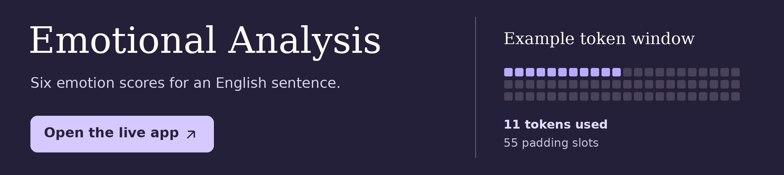
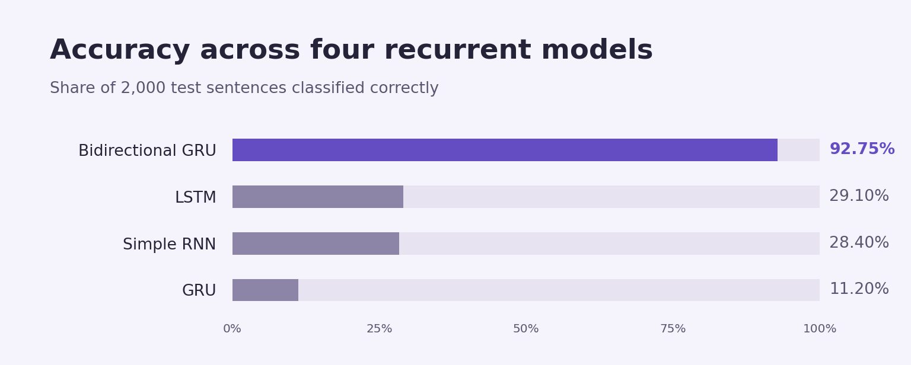
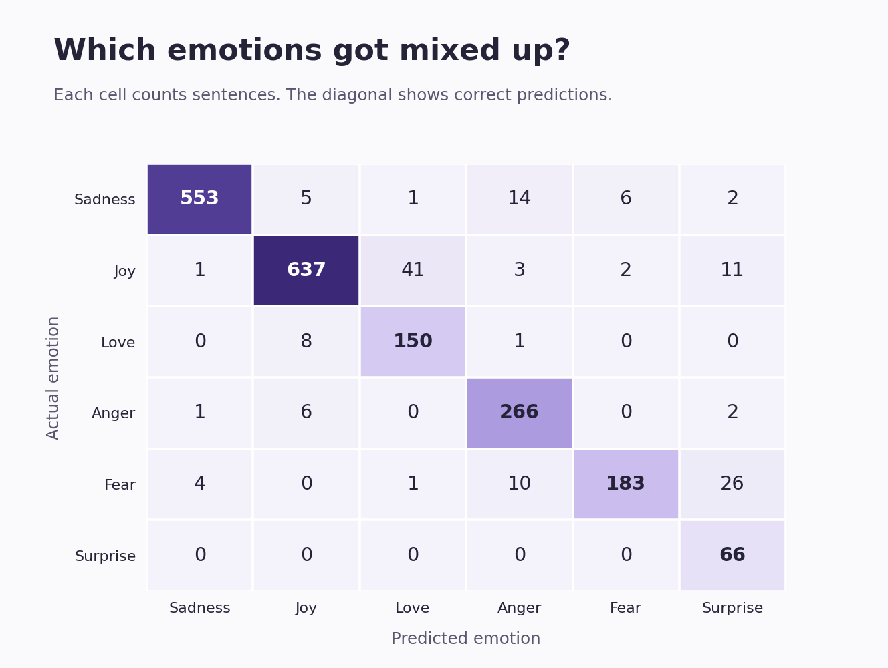

[](https://emotional-analysis-67df.onrender.com)

**Live website → [emotional-analysis-67df.onrender.com](https://emotional-analysis-67df.onrender.com)**  ·  [Interactive API](https://emotional-analysis-67df.onrender.com/docs)

Type an English sentence and select **Analyze emotion**. The app shows how a bidirectional GRU scores *sadness, joy, love, anger, fear,* and *surprise*. Beside the prediction, a 66-slot token window shows how much of the sentence reached the model.

> “My heart feels full of joy after hearing the good news.”
>
> The exported model predicts **joy** with **97.9% confidence**. The example uses **11 tokens**, leaving **55 padding slots**.

## What the notebook found

The notebook trained four recurrent models on 16,000 labeled sentences from the **DAIR.AI Emotion** dataset. The bidirectional GRU scored highest in this run and is the model deployed in the app.



**The BiGRU classified 1,855 of 2,000 sentences correctly (92.75%).** The notebook used the same test split to monitor early stopping and to report this score. An independent evaluation would select the training epoch on a separate validation split.

### Where the model struggled

The most frequent error was predicting **love** for a sentence labeled **joy** (41 cases). It also predicted **surprise** for 26 sentences labeled **fear**. Read across a row to see where sentences with the same true emotion ended up.



## From a sentence to six scores

1. **Tokenize.** The fitted tokenizer maps each word to its training vocabulary ID. Unfamiliar words map to the saved unknown-word ID.
2. **Fit the input.** The app keeps the first 66 tokens and pads shorter sequences with zeros on the right. The interface reports how many tokens it used or dropped.
3. **Predict.** A 300-dimensional embedding feeds two bidirectional GRU layers with 128 and 64 units per direction. A softmax layer produces six scores. The interface displays the highest-scoring label and its confidence.

## Model and tokenizer

FastAPI loads both notebook exports when the service starts. Keep the two files together inside `Models Exported/`.

| Project file | What it contributes |
| --- | --- |
| [BiGRU_Modle.keras](Models%20Exported/BiGRU_Modle.keras) | The trained network architecture and weights. The app uses the original filename, including the spelling `Modle`. |
| [tokenizer.pkl](Models%20Exported/tokenizer.pkl) | The fitted Keras tokenizer. It preserves the word-to-ID mapping that the model learned with. |
| [Emotional Analysis.ipynb](Notebooks/Emotional%20Analysis.ipynb) | Dataset exploration, label counts, model training, evaluation, confusion matrix, and export cells. |
| [predictor.py](predictor.py) | Tokenization, padding, inference, and conversion of model outputs into named emotions. |
| [main.py](main.py) and [static/](static/) | The FastAPI service and the browser interface for entering text and exploring scores. |

The notebook’s sample-prediction cell uses `maxlen=50`. To match the exported model and the app, use `maxlen=padded_train_sequence.shape[1]` (66) in that cell.

## Run locally

Clone the repository and open the folder containing `main.py` in VS Code. Run the following commands in a terminal. The repository includes both trained artifacts.

```shell
conda create -n emotion_env python=3.11 -y
conda run -n emotion_env python -m pip install -r requirements.txt
conda run -n emotion_env --no-capture-output python -m uvicorn main:app
```

If `emotion_env` already exists, start with the second command. When the terminal shows `Application startup complete`, open [the local app](http://127.0.0.1:8000). Once **Model online** appears, submit a sentence with **Ctrl + Enter**. Press **Ctrl + C** in the terminal to stop the server.

## API

| Endpoint | Response |
| --- | --- |
| `GET /` | The web interface. |
| `GET /health` | Whether the model loaded and the maximum input length. |
| `POST /predict` | The original text, predicted emotion, confidence, six probabilities, and token counts before and after truncation. |

To try a request, open the [live API explorer](https://emotional-analysis-67df.onrender.com/docs), expand **POST /predict**, and select **Try it out**.

```json
{"text": "My heart feels full of joy after hearing the good news."}
```

Requests accept 1–2,000 characters. Invalid or tokenless input returns HTTP `422`. If the model is unavailable, the health and prediction endpoints return HTTP `503`.

## Credits

- Training data comes from the [DAIR.AI Emotion dataset](https://huggingface.co/datasets/dair-ai/emotion).
- The notebook-to-web-app project was inspired by [Tanishq Vyas’s Emotion-Prediction](https://github.com/tanishq-latent/Emotion-Prediction).
- The interface uses DM Sans and Instrument Serif. Their licenses are included in [static/fonts/](static/fonts/).
